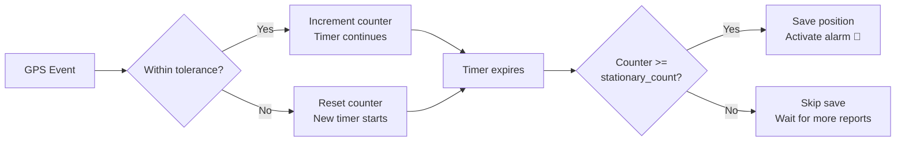
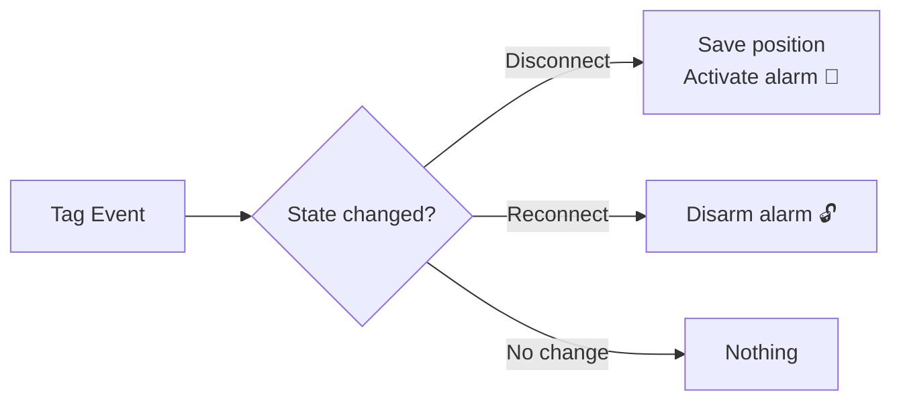
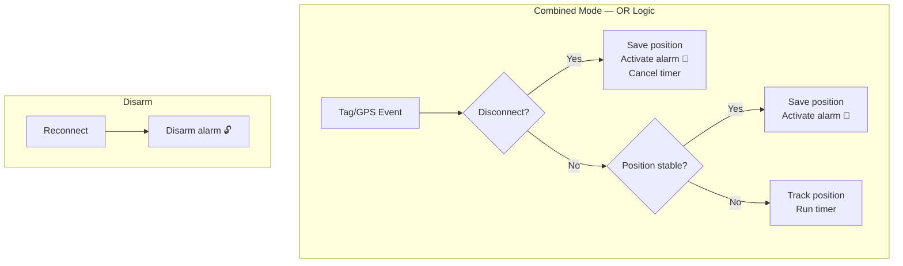

<p align="center">
  
</p>

# Tag Guard Vehicle

Home Assistant integration to monitor and protect your vehicle using a Bluetooth tracker (SmartTag, AirTag, Tile, etc.). 

## How It Works

**Never forget where you parked again, and get alerted if your vehicle is stolen or moved without permission.**

1. **🅿️ Automatic Position Saving** - When you park your vehicle, the integration automatically saves the GPS coordinates from your Bluetooth tracker
2. **🔐 Guard Activation** - After saving the position, monitoring is automatically activated (or manually, depending on your configuration)
3. **🗺️ Always Know Where You Parked** - The parking location is saved in the sensor, so you can always find your vehicle
4. **🚨 Theft/Movement Detection** - If your vehicle moves beyond the configured radius (default 500m), you receive an immediate notification
5. **💾 Persistent Storage** - Your parking location is saved across Home Assistant restarts

**Use Cases:**
- 🚗 **Anti-theft protection** - Get notified if your car is being stolen or towed
- 🏍️ **Motorcycle/bike security** - Monitor your two-wheeler in public parking
- 🚐 **RV/camper tracking** - Know if your recreational vehicle moves from the campsite
- 🅿️ **Never forget parking location** - Always know where you left your vehicle

## Features

- 🚗 **Automatic parking detection** - Monitors your Bluetooth tracker and saves parking location
- 📍 **Movement detection** - Alerts you if your vehicle moves beyond a set radius
- 🔔 **Smart notifications** - Customizable alerts via Home Assistant notify service
- 🌐 **Webhook control** - Remote control via POST/GET requests (with optional parameters)
- 🎯 **Multiple activation modes** - Choose how and when to activate monitoring
- 🌍 **Multi-language support** - English, Italian, French, German, Russian, Ukrainian, Chinese
- ⏰ **GPS freshness checking** - Only saves positions with recent GPS timestamps
- 🔄 **Smart waiting mode** - Automatically saves position when fresh GPS data arrives
- 📲 **Optional waiting notifications** - Get notified when waiting for fresh GPS update
- 🔐 **Reset logic** - New save requests cancel previous pending operations

## Supported Devices

Currently, the integration supports **Samsung SmartTag 2** devices connected via:
- [HA-SmartThings-Find (PixelShober fork)](https://github.com/PixelShober/HA-SmartThings-Find) - Modern active fork (optimized polling, state-change gating, and device discovery)
- [HA-SmartThings-Find (tomskra fork)](https://github.com/tomskra/HA-SmartThings-Find) - Fixed login issues
- [HA-SmartThings-Find (Vedeneb)](https://github.com/Vedeneb/HA-SmartThings-Find) - Original integration

You need one of these integrations installed to provide the `device_tracker` entity for your SmartTag.

**Note:** Support for other Bluetooth trackers (AirTag, Google, Tile, etc.) may be added in future releases.

## Installation

1. **Install SmartThings Find integration first:**
   - Install [PixelShober's](https://github.com/PixelShober/HA-SmartThings-Find) (recommended) or [tomskra's](https://github.com/tomskra/HA-SmartThings-Find) or [Vedeneb's](https://github.com/Vedeneb/HA-SmartThings-Find) integration
   - Configure your Samsung account
   - Verify your SmartTag appears as a `device_tracker` entity

2. **Install Tag Guard Vehicle:**
   - Copy `custom_components/tag_guard_vehicle` to your `<config>/custom_components/` folder
   - Restart Home Assistant

## Configuration

1. Go to **Settings** → **Devices & Services** → **Add Integration**
2. Search for "Tag Guard Vehicle"
3. Configure:
   - **Device Tracker**: Your Bluetooth tag entity (e.g., `device_tracker.smarttag`)
   - **Activation Mode**: How to detect parking (see below)
   - **Notify Service**: Home Assistant notification service to use
   - **Tolerance Radius**: Distance in meters before triggering alert (default: 500m)

### Activation Modes

- **`connection`** - Activates when Bluetooth disconnects (fastest)
- **`position`** - Activates when position is stable for X minutes (most accurate)
  - 📖 **[Complete Position Mode Guide](POSITION_MODE_GUIDE.md)** - Detailed configuration, timer behavior, troubleshooting
  - 🎯 **Smart GPS baseline detection** - First GPS timestamp saved as reference, counter increments only with fresh updates
  - ⚡ **Optimized processing** - Skips duplicate GPS updates to reduce log spam and improve efficiency
  - 🔄 **Auto-reset on stop** - Position tracking resets when alarm is deactivated for fresh monitoring
- **`combined`** - ❇️ **Automatic/smart mode** — arms at the FIRST event between disconnect (like connection) OR position stable (like position). Disarms on reconnect. Covers: walk away with phone, leave phone at home, lend vehicle to someone else. Recommended for most users.
- **`manual`** - Only activates via service call or webhook

### Activation Flow Diagrams

#### Position Mode (stable position triggers alarm)



#### Connection Mode (disconnect triggers alarm)



#### Combined Mode (OR logic — first event wins)



#### Mode Comparison

| Mode | Arms on disconnect | Arms on position stable | Disarms on reconnect | Best for |
|------|:---:|:---:|:---:|---------|
| `connection` | ✅ | ❌ | ✅ | Immediate detection, phone always with you |
| `position` | ❌ | ✅ | ❌ | Phone left at home, GPS reliability |
| `combined` | ✅ | ✅ | ✅ | General use, covers all scenarios |
| `manual` | ❌ | ❌ | ❌ | Manual control only |

## Usage

### Sensor State
The integration creates a sensor: `sensor.tag_guard_vehicle_<id>`

States:
- `position_saved` - Position saved, alarm disabled
- `parked` - Position saved, alarm enabled (monitoring)
- `alarm_triggered` - Vehicle has moved!
- `awaiting_position` - Waiting for fresh GPS data
- `unknown` - Initial state

### Services

#### Start Monitoring
Activates alarm and saves current GPS position.

```yaml
# Basic usage (default: checks GPS freshness)
service: tag_guard_vehicle.start

# With notification when waiting for fresh GPS
service: tag_guard_vehicle.start
data:
  notify_waiting: true

# Skip GPS freshness check (save immediately)
service: tag_guard_vehicle.start
data:
  require_fresh_position: false
```

**Parameters:**
- `require_fresh_position` (default: `true`) - Only save if GPS timestamp is newer than activation time
- `notify_waiting` (default: `false`) - Send "⏳ Waiting for fresh GPS..." notification if GPS is stale

#### Stop Monitoring
Deactivates alarm.

```yaml
service: tag_guard_vehicle.stop
```

#### Save Current Position
Saves position without activating alarm.

```yaml
# Basic usage
service: tag_guard_vehicle.save_position

# With GPS freshness check and notification
service: tag_guard_vehicle.save_position
data:
  require_fresh_position: true
  notify_waiting: true
```

**Parameters:** Same as start service (`require_fresh_position`, `notify_waiting`)

**GPS Freshness Logic:**
- ✅ **Fresh GPS**: Position saved immediately, alarm activated (if start)
- ⏳ **Stale GPS** (with `require_fresh_position: true`): 
  - Enters monitoring mode, waits for fresh GPS update
  - Automatically saves position when fresh GPS arrives
  - Optional notification with `notify_waiting: true`
- 🔄 **Reset**: New save/start call cancels previous waiting state

#### Mute/Unmute Notifications
Temporarily silence notifications without stopping monitoring.

```yaml
service: tag_guard_vehicle.mute_notifications
# or
service: tag_guard_vehicle.unmute_notifications
```

### Webhook Control

After setup, you get a webhook URL for remote control:
```
https://your-ha-instance.com/api/webhook/<your-token>
```

**POST Actions:**
```bash
# Start monitoring (basic)
curl -X POST https://your-ha/api/webhook/TOKEN \
  -H "Content-Type: application/json" \
  -d '{"action": "start"}'

# Start with GPS freshness check and notification
curl -X POST https://your-ha/api/webhook/TOKEN \
  -H "Content-Type: application/json" \
  -d '{"action": "start", "require_fresh_position": true, "notify_waiting": true}'

# Stop monitoring  
curl -X POST https://your-ha/api/webhook/TOKEN \
  -H "Content-Type: application/json" \
  -d '{"action": "stop"}'

# Save position (basic)
curl -X POST https://your-ha/api/webhook/TOKEN \
  -H "Content-Type: application/json" \
  -d '{"action": "save"}'

# Save with GPS freshness check
curl -X POST https://your-ha/api/webhook/TOKEN \
  -H "Content-Type: application/json" \
  -d '{"action": "save", "require_fresh_position": true, "notify_waiting": true}'

# Mute/unmute notifications
curl -X POST https://your-ha/api/webhook/TOKEN \
  -H "Content-Type: application/json" \
  -d '{"action": "mute"}'
```

**Available Actions:**
- `start` - Activate monitoring (params: `require_fresh_position`, `notify_waiting`)
- `stop` - Deactivate monitoring
- `save` - Save position without alarm (params: `require_fresh_position`, `notify_waiting`)
- `mute` - Silence notifications
- `unmute` - Re-enable notifications

**GET Interface:**
Open the webhook URL in a browser to access a simple control page with buttons.

## Example Automations

### Activate on Button Press
```yaml
automation:
  - alias: "Start Vehicle Guard - Basic"
    trigger:
      - platform: state
        entity_id: input_button.park_car
    action:
      - service: tag_guard_vehicle.start

  - alias: "Start Vehicle Guard - With GPS Check and Notification"
    trigger:
      - platform: state
        entity_id: input_button.park_car
    action:
      - service: tag_guard_vehicle.start
        data:
          require_fresh_position: true
          notify_waiting: true
```

### Activate via Mobile Notification
```yaml
automation:
  - alias: "Ask to Enable Guard When Parking"
    trigger:
      - platform: state
        entity_id: device_tracker.my_smarttag
        to: "not_home"
    action:
      - service: notify.mobile_app
        data:
          message: "Enable vehicle guard?"
          data:
            actions:
              - action: "START_GUARD"
                title: "Enable"

  - alias: "Enable on Mobile Action"
    trigger:
      - platform: event
        event_type: mobile_app_notification_action
        event_data:
          action: "START_GUARD"
    action:
      - service: tag_guard_vehicle.start
```

### Stop Guard When Home
```yaml
automation:
  - alias: "Disable Guard When Home"
    trigger:
      - platform: state
        entity_id: person.me
        to: "home"
    condition:
      - condition: state
        entity_id: sensor.tag_guard_vehicle
        state: "parked"
    action:
      - service: tag_guard_vehicle.stop
```

### Handle Awaiting Position State
```yaml
automation:
  - alias: "Notify When Waiting for Fresh GPS"
    trigger:
      - platform: state
        entity_id: sensor.tag_guard_vehicle
        to: "awaiting_position"
    action:
      - service: notify.mobile_app
        data:
          message: "Vehicle guard is waiting for fresh GPS data..."
          
  - alias: "Confirm Position Saved After Waiting"
    trigger:
      - platform: state
        entity_id: sensor.tag_guard_vehicle
        from: "awaiting_position"
        to: "parked"
    action:
      - service: notify.mobile_app
        data:
          message: "✅ Vehicle position saved with fresh GPS data!"
```

## Troubleshooting

### No notifications received
1. Check your notify service is working: `service: notify.mobile_app` (test it)
2. Verify `alarm_active: true` in sensor attributes
3. Check notification is not muted (`position_notified: false`)
4. Enable debug logging (see below)

### GPS position not saving
1. **Check GPS freshness**: By default, `require_fresh_position: true` ensures GPS is recent
   - Use `notify_waiting: true` to get notification when waiting for fresh GPS
   - Or set `require_fresh_position: false` to skip freshness check
2. **Verify device_tracker** has valid GPS coordinates (latitude/longitude)
3. **Check GPS timestamp**: Must be newer than activation time (format: YYYYMMDDHHMMSS)
4. **For position mode**: Ensure vehicle is stationary for configured minutes
5. **Check sensor state**: Look for `awaiting_position` state - means waiting for fresh GPS

### Stuck in "awaiting_position" state
1. Check `device_tracker` GPS timestamp is updating
2. Try with `require_fresh_position: false` to bypass freshness check
3. Call save/start again to reset waiting state
4. Check debug logs for GPS timestamp comparison details

### Debug Logging
Enable detailed logs:
```yaml
# configuration.yaml
logger:
  default: info
  logs:
    custom_components.tag_guard_vehicle: debug
```

Or via integration options: **Configure** → **Enable debug mode**

## Configuration Options

| Option | Description | Default |
|--------|-------------|---------|
| `device_tracker` | Your Bluetooth tracker entity | Required |
| `activation_mode` | When to activate: `combined`, `connection`, `position`, `manual` | `combined` |
| `notifier` | Home Assistant notify service | `notify.notify` |
| `tolerance_radius` | Alert distance in meters | `500` |
| `stationary_minutes` | Minutes stable before activation (position/combined modes) | `30` |
| `stationary_count` | GPS samples required (0=immediate, 1+=require fresh GPS) | `2` |
| `tag_model` | Parser model: `vedeneb_ha_smartthings_find` or `pixelshober_ha_smartthings_find` | `vedeneb_ha_smartthings_find` |
| `webhook_token` | Custom webhook token (auto-generated if empty) | Auto-generated |
| `debug_mode` | Enable verbose logging | `false` |

**Position Mode Notes:**
- `stationary_count=0`: Immediate activation after configured minutes (no GPS freshness check)
- `stationary_count=1+`: Requires N fresh GPS updates before activating (ensures accurate position)

## Advanced Features

### GPS Freshness Checking
The integration intelligently handles GPS timestamps to ensure accurate position saving:

**How it works:**
1. When `require_fresh_position: true` (default), the integration compares the GPS timestamp from your device tracker with the activation time
2. GPS timestamp format: `YYYYMMDDHHMMSS` (e.g., "20240115143022")
3. If GPS is **fresh** (newer than activation time):
   - ✅ Position saved immediately
   - 🟢 Alarm activated (for start action)
   - 📍 "Position saved" notification sent
4. If GPS is **stale** (older than activation time):
   - ⏳ Enters "awaiting_position" state
   - 🔍 Monitors device tracker for updates
   - 💾 Automatically saves when fresh GPS arrives
   - 📲 Optional notification with `notify_waiting: true`

**Reset behavior:**
If you call save/start while already waiting for fresh GPS, the previous waiting state is cancelled and replaced with the new request.

**Use cases:**
- **Immediate parking** - With `require_fresh_position: false` for instant save without GPS check
- **Accurate positioning** - Default behavior ensures you don't save old/cached GPS data
- **Monitoring mode** - With `notify_waiting: true` to track when waiting for GPS update

### Samsung SmartTag Integration
The integration can parse Samsung SmartThings webhook payloads automatically. Configure your SmartTag to send webhooks to the Tag Guard Vehicle webhook URL.

### State Persistence
Position and alarm state persist across Home Assistant restarts.

### Multiple Vehicles
Install multiple instances of the integration for multiple vehicles - each gets its own sensor and webhook.

## Contributing

Issues and pull requests welcome at: https://github.com/metagliatore/tag-guard-vehicle

## License

MIT License - see repository for details
